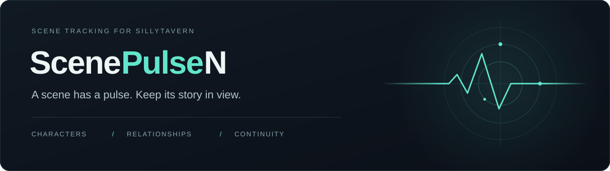

<div align="center">



# ScenePulseN

**Ваша история, её персонажи и всё, что меняется между ответами.**

Панель состояния сцены для SillyTavern: память о персонажах, история отношений,
квесты и сохранение установленных фактов.

[](manifest.json)
[](LICENSE)
[](https://github.com/l1kiru/SillyTavern-ScenePulseN/actions/workflows/ci.yml)

[English](README.md) · **Русский**

[Установка](#установка) · [Первый запуск](#первый-запуск) · [Руководство EN](docs/USER_GUIDE.md) · [История изменений](CHANGELOG.md) · [Сообщить о проблеме](https://github.com/l1kiru/SillyTavern-ScenePulseN/issues/new/choose)

</div>

---

## Сцена перед глазами

ScenePulseN извлекает структурированные данные из ответов ИИ и показывает их рядом
с ролевым чатом. Можно увидеть изменения, вернуться к состоянию на момент старого
сообщения или передать установленные факты в контекст следующего ответа.

| Что отслеживается | Что вы увидите |
| :--- | :--- |
| **Сцена** | Место, время, погода, настроение, напряжение и фоновые свидетели. |
| **Персонажи** | Внешность, мысли, цели, знания, физическое и эмоциональное состояние, установленные черты. Вики с поиском включает и отсутствующих персонажей. |
| **Отношения** | Привязанность, желание, доверие, стресс, совместимость, значимые события, конфликты и графики истории. |
| **Сюжет** | Основные и побочные квесты, обещания, встречи, планы персонажей и неразрешённые сюжетные зацепки. |
| **Непрерывность** | Предметы и их владельцы, факты мира, источники установленных знаний. |
| **Ваши системы** | Общие панели или поля каждого персонажа, фильтры персонажей, библиотека панелей и профили промптов со схемами. |

**Трекер описывает происходящее в истории.** Планы не выполняются за кадром, зацепки
не запускают события, а показатели отношений не диктуют реплики. Устойчивые факты
сохраняются до подтверждённого изменения; текущим эмоциям и реакциям нужны новые основания.

<details>
<summary><strong>Посмотреть интерфейс</strong> — примеры существующих панелей</summary>

Скриншоты показывают существующий интерфейс. Его вид может отличаться в вашей теме и текущей сборке.

**Обзор сцены**


**Отношения и их изменения**


**Пользовательские панели**


[Все возможности и скриншоты — EN →](docs/USER_GUIDE.md#features)

</details>

## Установка

Нужны **SillyTavern 1.18.0 или новее** и настроенное подключение к ИИ.

> [!WARNING]
> Перед установкой ScenePulseN отключите или удалите оригинальный ScenePulse.
> Расширения используют общие обработчики генерации и идентификаторы сохранённых
> данных. Одновременная работа может дублировать запросы и перезаписывать состояние.

1. В SillyTavern откройте **Расширения → Установить расширение** (Extensions → Install Extension).
2. Вставьте адрес репозитория:

   ```text
   https://github.com/l1kiru/SillyTavern-ScenePulseN
   ```

3. Установите расширение и перезагрузите SillyTavern.

<details>
<summary>Ручная установка через Git</summary>

Для пользователя SillyTavern по умолчанию выполните из каталога SillyTavern:

```bash
cd data/default-user/extensions/third-party
git clone https://github.com/l1kiru/SillyTavern-ScenePulseN
```

Если используется другой пользователь, выберите его каталог расширений.
После установки перезапустите SillyTavern.

</details>

## Первый запуск

1. Откройте чат и настройки **Расширения → ScenePulse**. Некоторые элементы
   интерфейса сохраняют оригинальное название ScenePulse.
2. Пройдите мастер настройки. Выберите профиль подключения для восстановления,
   если хотите автоматически получать данные, когда ИИ пропускает встроенный трекер.
   В текущем **Unreleased** мастер начинается с выбора языка; в выпущенной версии
   язык также доступен в настройках.
3. Оставьте **Together** — режим по умолчанию — или выберите **Separate** для
   отдельного запроса трекера. Включённая автогенерация обновляет данные после ответов.
4. Отправьте сообщение. На компьютере откройте боковую панель, на телефоне —
   плавающий значок, чтобы увидеть извлечённое состояние сцены.
5. В **Panel Manager** выберите нужные поля и панели. Используйте таймлайн для
   просмотра прошлых снимков, а вики персонажей — для просмотра участников истории.

Если данные устарели, выполните `/sp-refresh`. Если панель тормозит, включите
**General → Reduce visual effects**. В [подробном руководстве на английском](docs/USER_GUIDE.md)
описаны команды, макросы, темы, профили и ручное редактирование.

## Режимы отслеживания

| | Together · по умолчанию | Separate |
| :--- | :--- | :--- |
| **Извлечение** | ИИ добавляет блок трекера к сюжетному ответу; блок скрывается из видимого сообщения. | Отдельный запрос извлекает состояние после сюжетного ответа. |
| **Подключение** | Основная генерация; для восстановления можно выбрать другой профиль. | Для трекера можно использовать сохранённый профиль подключения. |
| **Когда подходит** | Модель надёжно выполняет инструкции и добавляет структурированные данные. | Нужен отдельный профиль трекера или сюжетная модель плохо справляется со встроенным блоком. |
| **Затраты** | Инструкции и результат трекера входят в основной запрос. | Дополнительные запросы увеличивают задержку и расход API. |

**Delta-обновления** переносят неизменившиеся данные и периодически запрашивают
полное состояние. Экономия зависит от модели и сцены. **Параллельное извлечение**
необязательно, изначально выключено и доступно в Separate с сохранённым профилем
подключения. Больше одновременных запросов не всегда означает быстрее.
Автоматический выбор пользовательских панелей требует Separate с параллельным извлечением.

Together включает предыдущее состояние сцены в контекст. В Separate включите
**Embed snapshots**, чтобы следующий сюжетный ответ получил этот контекст.
В собственных схемах и полных переопределениях промпта нужные поля необходимо указать явно.

[Подробности генерации и восстановления — EN →](docs/USER_GUIDE.md#how-it-works)

## Текущая версия и подготовленные изменения

**Последний релиз: v7.1.16** — JSON-контракты на основе схемы, более надёжное
извлечение, согласованное обновление разделов и сохранение подтверждённых фактов сцены.

В рабочем дереве также подготовлены улучшения **Unreleased**. Версия остаётся
7.1.16; эти дополнения не являются отдельным опубликованным релизом:

- Выбор языка в начале настройки и улучшенная компоновка мастера на телефоне.
- Диагностика API хоста, интеграция скрытия трекера и прямые запросы через профиль
  подключения при наличии необходимых API SillyTavern.
- Подтверждение смены персоны для каждого чата и явное действие **Clean**.
  Очистка сбрасывает настройки, пользовательские профили промптов/схем и кэши,
  сохраняя библиотеку панелей и снимки в чатах.
- Нативный индикатор построения сцены с отменой, последовательная обработка
  ответов группового чата и исправления восстановления Together после отмены.
- Оценка токенов для разных языков, подбор пресетов, проверка данных в Doctor,
  сохранность исторической трассировки источников и мысли из выбранного снимка таймлайна.

[Полный список изменений](CHANGELOG.md#unreleased) · [Проверки и оставшиеся пробелы](tests/README.md)

## Настройте под свою историю

Доступны шесть тем, масштабирование текста, мобильная компоновка, поддержка
уменьшения анимации, **английский язык и 29 словарей локализации**. Русский словарь интерфейса заполнен
полностью; остальные переводы частичны и используют английский для недостающих
строк. Подробности — в [отчёте о покрытии](locales/_coverage.json).

Создавайте профили промптов и схем для разных миров, добавляйте панели здоровья,
маны, репутации и отношений с фракциями. Для диагностики есть Debug Inspector,
сравнение данных, аналитика токенов и включаемая отдельно Scene Source Trace.
ИИ может пропускать или неверно трактовать факты: важные данные можно проверить и исправить.

| Подробнее | Содержание |
| :--- | :--- |
| [Руководство — EN](docs/USER_GUIDE.md) | Возможности, настройки, режимы, команды и ограничения. |
| [Пользовательские панели — EN](docs/USER_GUIDE.md#custom-panels) | Типы полей, панели персонажей и требования к собственной схеме. |
| [Пресеты моделей — EN](presets/README.md) | Формат, примеры и порядок добавления пресетов. |
| [Архитектура — EN](ARCHITECTURE.md) | Модули, хранение состояния, генерация и правила непрерывности. |
| [Тестирование и совместимость — EN](tests/README.md) | Автотесты, проверки в SillyTavern и известные пробелы покрытия. |

## Участие в проекте

[Сообщите об ошибке или предложите улучшение](https://github.com/l1kiru/SillyTavern-ScenePulseN/issues/new/choose),
помогите с переводом или поделитесь проверенным пресетом. Для советов по настройке
указывайте модель, провайдера, изменённые параметры и наблюдаемый результат.
Обращения можно писать на русском или английском.

[Руководство для участников — EN](CONTRIBUTING.md) · [Сообщить об уязвимости — EN](SECURITY.md) · [Примеры пресетов](presets/_examples/)

## Авторы и лицензия

ScenePulseN — поддерживаемый сообществом форк [ScenePulse](https://github.com/xenofei/SillyTavern-ScenePulse).
Автор оригинального проекта и основной архитектуры — [xenofei](https://github.com/xenofei).
**Форк ScenePulseN поддерживает [l1kiru](https://github.com/l1kiru).**

Спасибо проектам, вдохновившим ScenePulse: [RPG Companion](https://github.com/SpicyMarinara/rpg-companion-sillytavern),
[Dooms Enhancement Suite](https://github.com/DangerDaza/Dooms-Enhancement-Suite),
[WTracker](https://github.com/bmen25124/SillyTavern-WTracker) и
[zTracker](https://github.com/Zaakh/SillyTavern-zTracker).

[GPL-3.0](LICENSE). Включённая библиотека jsonrepair сохраняет свою [лицензию ISC](src/vendor/jsonrepair.LICENSE).
